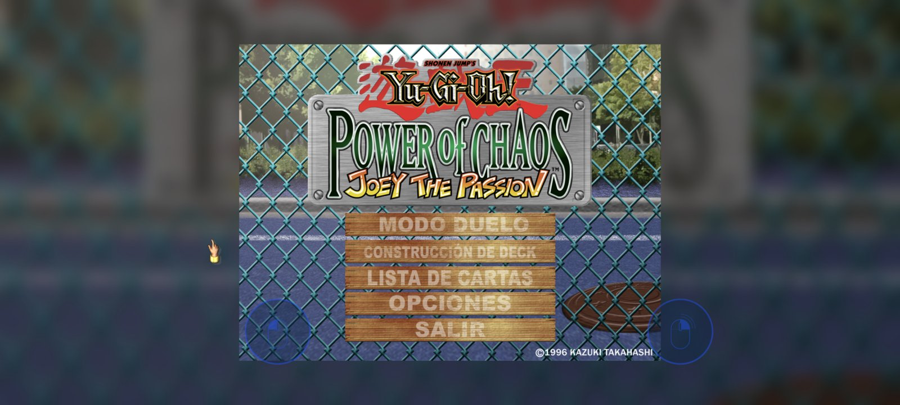
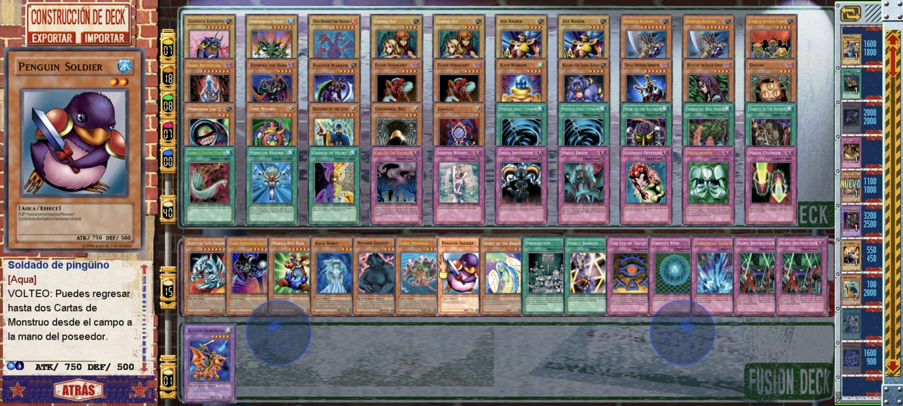
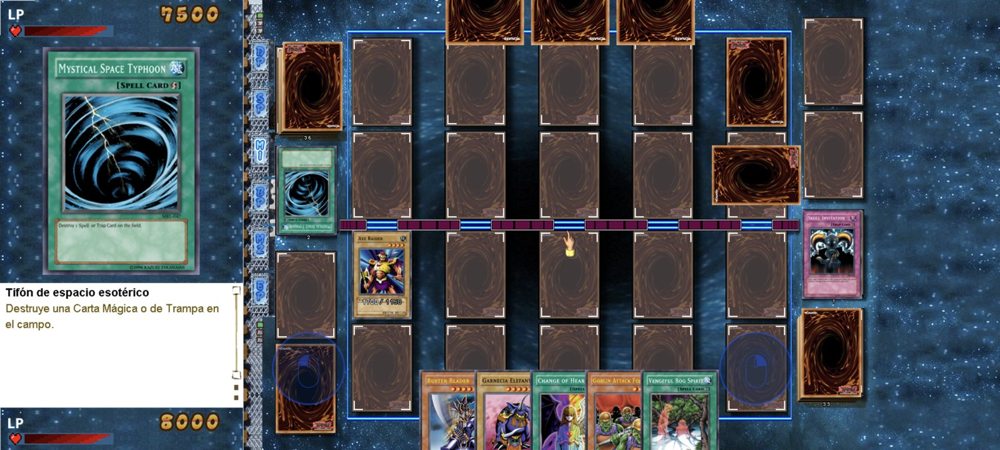

<h1 align="center">Engine Virtualized</h1>
<p align="center"><b>La trilogía <i>Yu-Gi-Oh! Power of Chaos</i> (PC, edición española) en Android, dentro de una máquina Windows virtualizada.</b></p>

<p align="center">
  <a href="https://github.com/codecsrayo/engine-virtualized/releases/latest">
    
  </a>
  
  
</p>

<p align="center">
  
  
</p>
<p align="center">
  
</p>

## Qué es

No es un port ni un motor nuevo del juego. La app ejecuta **los `.exe` originales de Windows** dentro de
una máquina Windows virtualizada que corre en el propio teléfono:

```
Android (arm64)
└── Bannerlator / Winlator          entorno Linux y servidor X dentro de la app
    └── Proton 11 arm64ec (Wine)    la "máquina Windows": registro, unidades C: D: E: G:, GDI...
        └── WowBox64                traduce el código x86 de 32 bits del juego a ARM64
            └── joey_pc.exe / yugi_pc.exe / kaiba_pc.exe
```

Todo eso va dentro del APK y se prepara solo la primera vez. Es un *fork* de
[Bannerlator](https://github.com/The412Banner/Bannerlator) 3.1.5 (basado en Winlator) con un modo kiosco:
no se ve la interfaz del emulador, solo un selector de juegos.

**No incluye ningún juego**: necesitas tus propias copias (las ISOs de los CDs o una ISO hecha con tu
juego instalado).

## Juegos

| Juego | Cómo se instala desde la ISO | Resolución | Estado |
|---|---|---|---|
| *Joey the Passion* | archivos sueltos (`Joey_Pc.exe`, `Data.dat`, `Voice.dat`, `Region.dat`) | 1708x768 con el parche HD, o 800x600 | probado en el teléfono |
| *Yugi the Destiny* | `Data1.cab` del CD + `Crack\yugi_pc.exe` | 800x600 | contenido de la ISO revisado en el PC; falta probarlo en el teléfono |
| *Kaiba the Revenge* | `Data1.cab` del CD + `Crack\kaiba_pc.exe` | 800x600 | contenido de la ISO revisado en el PC; falta probarlo en el teléfono |

Los tres comparten partidas (`system.dat`) y el ID de jugador, como en el PC.

## Requisitos mínimos

| | Mínimo | Probado / recomendado |
|---|---|---|
| Sistema | Android 8.0 (API 26) | Android 16 (HyperOS 3) |
| Arquitectura | **arm64-v8a** (no funciona en x86 ni en el emulador de Android Studio) | |
| CPU | 64 bits ARMv8.2 de gama media | Snapdragon 7s Gen 3 o superior para ir fluido a 1708x768 |
| GPU | Vulkan 1.1 (los juegos no usan 3D) | Adreno 810 |
| RAM | 4 GB (cada juego usa ~0,5 GB) | 6 GB o más |
| Almacenamiento | APK ~0,7 GB + sistema base y Proton ~1,3 GB + por juego, sus archivos más una copia interna (Joey HD ~1,4 GB, Yugi ~0,65 GB, Kaiba ~0,85 GB). Al importar hace falta además el doble de la ISO, de forma temporal | |
| Kernel | Páginas de 4 KB (en kernels de 16 KB Box64/Wine pueden fallar) | |

Solo se ha probado en un Redmi Note 14 Pro+ 5G.

## Instalación

1. Descarga el APK de la [última release](https://github.com/codecsrayo/engine-virtualized/releases/latest)
   e instálalo. Aparece como **Engine Virtualized**.
2. Copia tus ISOs al teléfono (a `Download`, por ejemplo).
3. Abre la app. En cada juego pulsa **Importar ISO** y elige su ISO. La app la copia a su carpeta, la
   descomprime y deja el juego listo. Después puedes borrar la ISO de `Download`.
4. Pulsa **Jugar**. La primera vez tarda un poco más, porque prepara la máquina virtual. Al salir del
   juego se cierra la app.

La app gestiona todo lo demás: no hay que copiar archivos a mano ni conceder "Acceso a todos los
archivos". Es una app nueva (no sustituye a la versión anterior, solo Joey, que leía `Download/YGO_Joey_HD`)
y empieza con partidas nuevas.

### Qué ISOs sirven

La app reconoce de qué juego es cada ISO: si la importas desde la tarjeta de otro juego, se instala igual
en el suyo.

- **Los CDs originales en español** de Yugi y Kaiba: la app descomprime `Data1.cab` (no ejecuta el
  instalador) y usa el exe de `Crack\`, que funciona sin el disco. El `system.dat` que traen algunas ISOs
  se ignora: nunca sustituye a tus partidas.
- **Una ISO "lista"**, con el juego ya preparado: el exe junto a `Data.dat` en cualquier carpeta de la
  ISO (por ejemplo `yugi_pc.exe`, `Data.dat`, `Voice.dat` y `Region.dat` en la raíz). Se copia tal cual,
  sin descomprimir nada más. Así se pasa Joey con el parche HD: una ISO con `Joey_Pc.exe`, `Data.dat`,
  `Voice.dat` y `Region.dat` (sin tu `Deck.ydc`). Se puede hacer con cualquier programa de ISOs a partir
  de la carpeta del juego instalado, o de un CD original: los archivos de `Data1.cab` más el exe de
  `Crack\`.
- Un CD que solo tenga un instalador sin `Data1.cab`: la app ejecuta su `setup.exe` dentro de la máquina
  virtual y, al terminar, recoge lo instalado (sin probar todavía con un CD real).

## Dónde quedan los archivos

Todo vive en la carpeta propia de la app, no en `Download`:

```
Android/data/com.laste.enginevirtualized/files/
├── Joey/      Joey_Pc.exe  Data.dat  Voice.dat  Region.dat  Deck.ydc  (kiosk.ini)
├── Yugi/      yugi_pc.exe  Data.dat  Voice.dat  Region.dat  Deck.ydc
├── Kaiba/     kaiba_pc.exe data.dat  Voice.dat  Region.dat  Deck.ydc
├── Yu-Gi-Oh! Power of Chaos Common/
│   └── system.dat          tus cartas y progreso (compartido por los tres)
├── backups/                copia de system.dat y del mazo antes de cada partida (las últimas 20)
└── ISO/                    temporal mientras se importa una ISO
```

> **Android borra esta carpeta al desinstalar la app.** Antes de desinstalar, usa **Exportar todo**
> (abajo). Actualizar la app encima, firmada con la misma clave, no borra nada.

## Exportar e importar partidas

Con el selector de archivos de Android, sin tocar carpetas:

- **Exportar mazo / Importar mazo** (en cada juego): el `Deck.ydc` de ese juego.
- **Exportar todo / Importar todo**: un `.zip` con los tres mazos y `system.dat`, para guardar las
  partidas o pasarlas a otro teléfono.

El juego reinicia las partidas si un mazo lleva otro ID de jugador. Por eso, al importar:

- se comprueba que el archivo es de verdad un mazo (estructura exacta del `.ydc`);
- un mazo de otro jugador **recibe tu ID** antes de guardarse, y conserva sus cartas;
- un `.zip` que trae su propio `system.dat` es un cambio de jugador completo y mantiene sus IDs;
- antes de importar se copia todo lo actual a `backups/<fecha>_antes_importar/`.

Sin probar: qué hace el juego con un mazo importado que lleve cartas que no tienes en tu `system.dat`.

## Qué tiene de especial

- **Tus partidas a salvo**: el juego guarda un ID de jugador cifrado en el registro (`flcrc`). En una
  máquina virtual nueva inventaría otro y **reiniciaría las partidas**. La app lo reconstruye desde tu
  `Deck.ydc` antes de cada arranque. Si falta el mazo pero hay partidas, lo restaura desde `backups/`, y si
  tampoco hay copia, no abre el juego. El cifrado
  está verificado con el exe de Joey. Yugi y Kaiba usan el mismo esquema, pero eso aún no está
  comprobado; por eso se hace la copia de `backups/` antes de cada partida.
- **Fluido**: con Proton arm64ec + WowBox64, el dibujado por software a 1708x768 cabe en el presupuesto de
  cada fotograma (con Wine x86_64 + Box64 iba a ~10-13 FPS).
- **Cargas instantáneas**: los archivos de solo lectura del juego se copian a la memoria interna (sin FUSE),
  y la app los actualiza sola cuando cambian.
- **Ajustable sin recompilar** con un `kiosk.ini` en la carpeta de cada juego.

Los detalles técnicos, las mediciones y cómo compilar están en [README-ENGINE.md](README-ENGINE.md).

## Compilar

```bash
export JAVA_HOME="<Android Studio>/jbr"   # JDK 21
./gradlew assembleEngineRelease
```

Requiere Android SDK (platform 34, build-tools 35, NDK 29.0.14206865, CMake 3.22.1). La primera compilación
descarga y verifica por sha256 el sistema base de Bannerlator y Proton 11.0-2 arm64ec. Para firmar con tu
propia clave crea `keystore/engine-signing.properties` (`storeFile`, `storePassword`, `keyAlias`,
`keyPassword`; también vale el antiguo `joey-signing.properties`). Sin ella el APK se firma con la clave de
pruebas de AOSP.

## Créditos y licencia

- [Bannerlator](https://github.com/The412Banner/Bannerlator) (The412Banner) y [Winlator](https://github.com/brunodev85/winlator)
  (brunodev85), GPL-3.0. Este repositorio conserva su código, su historial y su licencia
  ([LICENSE](LICENSE), [README original](README-BANNERLATOR.md)).
- Proton 11.0-2 arm64ec y la capa base: publicados por The412Banner en
  [winlator-contents](https://github.com/The412Banner/winlator-contents).
- 7-Zip (7zz), incluido en Bannerlator, para descomprimir las ISOs y los `.cab`.
- *Yu-Gi-Oh! Power of Chaos* © Kazuki Takahashi / Konami. Proyecto no oficial, sin relación con Konami.
  No se distribuye ningún juego: usa tus propias copias.
